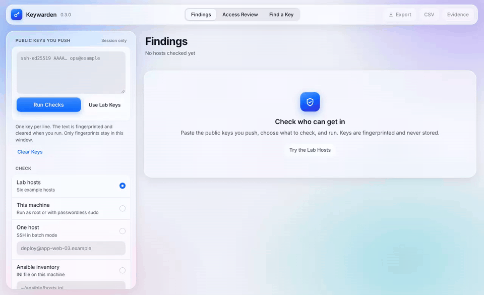

# Keywarden

Check SSH posture around the public keys you already push. Keywarden does not push keys, and it does not store them.

You keep using whatever already places `authorized_keys` on a machine (Ansible, a script, by hand). Keywarden reads the effective daemon config and the keys that are actually authorized, fingerprints those keys, and drops the bodies before it writes a report.

One command checks this machine, one host, or every host in an Ansible inventory. It is a point-in-time check: there is no daemon, scheduler, or stored state.



`keywarden ui` on the built-in lab hosts. Screenshots: [findings, light](https://raw.githubusercontent.com/generalwax2018/keywarden/main/docs/screenshots/findings-light.webp) · [findings, dark](https://raw.githubusercontent.com/generalwax2018/keywarden/main/docs/screenshots/findings-dark.webp) · [access review](https://raw.githubusercontent.com/generalwax2018/keywarden/main/docs/screenshots/access-review.webp).

## Install

Python 3.9 or newer. No third-party packages. `--local` needs Linux or another POSIX system; the browser UI, `--host`, and `--inventory` also run on Windows using its built-in `ssh`.

```sh
python3 -m pip install keywarden-ssh
```

Or straight from a tag:

```sh
python3 -m pip install "git+https://github.com/generalwax2018/keywarden.git@v0.3.0"
```

The distribution name is `keywarden-ssh`. The `keywarden` package on PyPI is an unrelated project; do not install it expecting this tool.

Or clone this repository and run it from the tree:

```sh
git clone https://github.com/generalwax2018/keywarden.git
cd keywarden
PYTHONPATH=src python3 -m keywarden --version
```

## Use it in a browser

```sh
keywarden ui
```

This opens Keywarden in a browser tab, served from your machine. Paste the public keys you push, choose what to check (this machine, one host, an Ansible inventory, or collector output you paste), and run. Results show failing hosts first, with the access review table and a "find a key" search beside them. Export the findings as JSON or the key table as CSV. Press **Fill lab keys** and **Run checks** to try it on six made-up hosts first.

The server listens on `127.0.0.1` only, on a random port, and the link it prints carries a one-time token. It refuses requests without that token, from another web page, or with a Host header other than localhost, so a site you visit cannot drive it. The page loads nothing from the internet. Key text is fingerprinted on arrival and cleared from the box; the tab holds fingerprints only, and nothing is written to disk unless you export. Use `--port` to pick the port and `--no-browser` to print the link without opening it.

## Check this machine

```sh
keywarden check --local --allow team.pub
```

`team.pub` is the public keys you intend to be authorized, one OpenSSH line each. Keywarden fingerprints them for the comparison and does not copy them into the report.

A failing check exits 1. A clean or warning-only check exits 0. Bad input, including a private key, exits 2 and writes no report.

The terminal shows a summary line, then failures and warnings in colour. Passing checks are counted but hidden; `--verbose` lists them. Colour is off when the output is not a terminal or `NO_COLOR` is set, and `--color always|never` overrides it.

```sh
keywarden check --local --allow team.pub --output keywarden-report.json
```

The JSON file has fingerprints, key types, bit lengths, comments, daemon settings, and findings. It does not have key bodies. Do not point `--allow` at a private key. If one is present, Keywarden stops and keeps nothing.

## Check one other host

```sh
keywarden check --host deploy@app-web-03.example --allow team.pub --json
```

This is `ssh` in batch mode (no password prompt). The remote command prints `sshd -T` and `authorized_keys` back to this process. Fingerprints are computed here. Nothing is written on the remote host.

A host key that is missing or changed fails the connection. Keywarden does not accept it. `--accept-new` trusts a key you have not seen before and is off unless you pass it. Use the `known_hosts` file your SSH client already has.

Reading root, and reading other accounts, needs to be allowed: run as root, or have passwordless `sudo`. With general passwordless sudo the collector uses it for `sshd -T`, `stat`, `test`, `ls`, `grep` of the sshd config, and `cat` of `authorized_keys`. With sudo limited to `sshd -T` and `cat`, those two still work, and file modes behind an unreadable home are reported as unknown. If root's file cannot be read, the root-key check is a **warning, not a pass**. A hidden root key must not look clean, and an account whose home cannot be read is listed as not checked instead of being skipped.

Every line read from an `authorized_keys` file is prefixed before it crosses the wire, and the parser refuses output that is out of order, repeated, or truncated. A user who writes collector markers into their own key file cannot change what the report says about the daemon or other accounts; the host fails with `collector-output` instead.

`--account` adds a specific user. Repeat it. Accounts that already have an `authorized_keys` file are included when the file is visible.

## Check an Ansible inventory

```sh
keywarden check --inventory hosts.ini --allow team.pub
```

`hosts.ini` is the INI inventory you already use. Keywarden reads `ansible_user`, `ansible_host`, `ansible_port`, and `ansible_ssh_private_key_file` (and their `ansible_ssh_*` spellings), from host lines, `[group:vars]`, and parent groups through `[group:children]`. A nearer group overrides a parent, and a host line overrides both, as in Ansible. A private-key path is handed to `ssh -i`; Keywarden never opens the file. Passwords, become passwords, and every other variable are dropped as the file is read. YAML inventories are not supported yet and are refused with a message. Each host is one SSH, in order. A host that cannot be reached is a failure, and the rest are still checked.

The terminal shows failures only. A check that names a key is printed once per fingerprint, with every host where that fingerprint failed. Other failures stay on their own line: hostname and check. Passes are not printed. Exit 1 if any host failed. `--output` writes the JSON report, still without key bodies. The `fingerprints` array is the unique set. `--prior` is for one host, not an inventory.

```ini
[web]
app-web-03 ansible_user=deploy
bastion ansible_host=10.0.0.9 ansible_user=ops ansible_port=2222
```

There is no scheduler. The next run is the next time you start the command.

## What is checked

| Code | Fails when |
| --- | --- |
| `permit-root` | `PermitRootLogin` is anything but `no`. `prohibit-password` and `without-password` still allow a root key, so they fail. |
| `password-auth` | `PasswordAuthentication` is on |
| `keyboard-interactive` | `KbdInteractiveAuthentication` is on |
| `empty-passwords` | `PermitEmptyPasswords` is on |
| `pubkey-auth` | `PubkeyAuthentication` is off |
| `root-authorized-key` | root has a key. Unreadable is a warning. |
| `root-account` | another account has uid 0, root is missing, or root's password field is empty |
| `permissions` | `.ssh` or `authorized_keys` is group- or world-accessible |
| `weak-algorithm` | DSA, or RSA under 3072 bits |
| `outside-push` | a non-root key is not in `--allow` |
| `cert-authority` | a line is marked `cert-authority` |
| `ssh-certificate` | a certificate is expired, not yet valid, a host certificate, or unreadable |
| `accepted-algorithms` | `PubkeyAcceptedAlgorithms` still allows `ssh-rsa`, `ssh-dss`, or SHA-1 |
| `ca-algorithms` | `CASignatureAlgorithms` still allows those |
| `trusted-user-ca` | `TrustedUserCAKeys` is set, so a signed key can bypass the push |
| `revoked-keys` | a user CA is trusted and `RevokedKeys` is none (warning) |
| `authorized-keys-command` | a command can inject keys that are not in the file |
| `authorized-keys-file` | `sshd` also reads a path other than `.ssh/authorized_keys` |
| `hostbased-auth` | host-based authentication is on |
| `auth-methods` | `AuthenticationMethods` still allows a password |
| `sshd-config` | `sshd -T` could not run, so daemon checks were skipped (warning) |
| `match-blocks` | `sshd_config` has `Match` blocks (warning; see below) |
| `collector-output` | the collector output was malformed or tampered with |
| `unreachable` | an inventory host could not be reached |
| `key-to-root` | a key opens an account with passwordless root: `NOPASSWD` sudo to a shell or `ALL`, or a root-equivalent group such as `docker` (warning) |
| `key-source` | a root-level key has no `from=` restriction (warning) |
| `forced-command-forwarding` | a `command=` key still allows port or agent forwarding (warning) |
| `key-environment` | a key sets `environment=` and `PermitUserEnvironment` is on |
| `expired-key` | a line's `expiry-time` has passed, or cannot be read (warning) |
| `log-level` | `LogLevel` is `QUIET`, `FATAL`, or `ERROR`, so logins are not recorded |
| `auth-log` | the sshd log could not be read, so key usage was not checked (warning) |
| `stale-key` | an authorized key has no login in `--stale-days` (default 90). A warning when the logs are shorter than that. |

Fields that are absent from the observation are skipped, not treated as a pass.

`sshd -T` prints the default settings, before any `Match` block applies. When the config has `Match` blocks, Keywarden also runs `sshd -T -C user=root,...` and fails `permit-root`, `password-auth`, or `keyboard-interactive` if a block makes root worse than the default. A `Match` block can only make a result worse, never better. Blocks for other users, groups, or source addresses are not evaluated; `match-blocks` warns so you know to read them.

Key text is fingerprinted in memory and then dropped. A private key, including a PuTTY private key, stops the run and is not written. The report never contains a key body. `--allow` is not deleted; it is your file.

`forced-commands-only` is a warning. Pass `--no-weak` or `--no-outside` to skip those two comparisons.

Key comments are often an email address or a machine name. Pass `--redact-comments` to leave them out of the terminal output and the report.

## Access review

Every check also builds a table with one row per authorized key: host, account, fingerprint, type, comment, whether it is in `--allow`, what logging in leads to (`reach`), its `from=` and other options, and when it was last used.

```sh
keywarden check --local --allow team.pub --keys
keywarden check --inventory hosts.ini --allow team.pub --csv access-review.csv
```

`--keys` prints the table. `--csv` writes it for a spreadsheet or a ticket. The JSON report has it under `keys`. Cells that start with `=`, `+`, `-`, or `@` are prefixed with `'` so a key comment cannot run as a spreadsheet formula. A `command=` value is never printed, only that one is set, because forced commands sometimes carry tokens.

**Reach.** For each account with a key, Keywarden reads `sudo -l -U <account>` and the account's groups:

| Reach | Meaning |
| --- | --- |
| `root` | the account is root, or uid 0 |
| `root-nopasswd` | `NOPASSWD` sudo to `ALL`, a shell, or a command with a known shell escape (`vim`, `less`, `find`, `tee`, `systemctl`, and others), or membership in `docker`, `lxd`, `lxc`, `incus-admin`, or `disk` |
| `root-password` | the same sudo rules, but with a password; or membership in `sudo`, `wheel`, or `admin` when the rules cannot be read |
| `limited` | sudo to specific commands that are not on the shell-escape list. The list is not exhaustive; review these rules by hand. |
| `none` | not in sudoers, or sudo is not installed |
| `unknown` | sudo rules could not be read (run as root or with passwordless sudo) |

Each `sudo -l -U` call is written to the host's auth log by sudo itself.

**Last used.** Keywarden reads `Accepted publickey for <account> ... SHA256:<fingerprint>` lines. sshd writes these at the default `LogLevel INFO`. It prefers the systemd journal, read only for `ssh.service` and `sshd.service` entries logged as uid 0, which a local user cannot forge. Without a journal it reads `/var/log/auth.log*` or `/var/log/secure*`, including rotated and gzipped files. A local user can write fake lines to those files with `logger`, so the report names which source it used (`authLog`). The log tells you how far back it reaches; a key is only called stale when the logs cover the whole `--stale-days` window. A login through a certificate counts toward the `cert-authority` line that trusted it. A certificate pasted directly into `authorized_keys` is marked `unmatched`, because sshd logs the key inside it rather than the line.

Only the newest login line and a count per account and key leave the host. Pass `--redact-addresses` to drop the last login address from the output.

## Evidence for an assessor

```sh
keywarden check --inventory hosts.ini --allow team.pub --waivers keywarden.toml --evidence ssh-evidence.html
```

`--evidence` (or **Evidence** in `keywarden ui`) writes one self-contained HTML file: who ran the check and with what visibility, the hosts in scope, every finding with the controls it bears on, the access review table, accepted risks, and a SHA-256 of the embedded JSON report so an assessor can tell it was not edited. A control coverage table groups the results under CIS Controls v8, NIST SP 800-53 Rev. 5, PCI DSS v4.0, and NERC CIP. Every finding in the JSON report also carries its `controls`.

The mapping is in [docs/compliance.md](docs/compliance.md). It supports an assessment and does not replace one: a passing check is evidence toward a control on the hosts checked, not proof the control is met.

## Find a key

Offboarding someone, or a laptop was stolen: find every place their key gets in.

```sh
keywarden where --key alice.pub --inventory hosts.ini
keywarden where SHA256:CU0yV+3RbcXlukC+M6dq938Ou+kt105Ipe/qaP4n4LU --host deploy@app-web-03.example
```

Each hit names the host, the account, whether the key is in `authorized_keys` or trusted as a `cert-authority`, its reach, its `from=` limit, and its last login. A key that logged in recently but is not in any readable `authorized_keys` is listed too: it may come from `AuthorizedKeysCommand`, another key file, or a file Keywarden could not read. Hosts and accounts that could not be read are printed on stderr, because "not found" only covers what was visible.

Like `grep`, `where` exits 0 when it finds the key, 1 when it does not, and 2 on bad input. A private key passed to `--key` is refused.

## Waivers

Some findings are deliberate: a break-glass key on root, an admin account with passwordless sudo. Record them instead of turning the check off:

```toml
# keywarden.toml (Python 3.11+), or the same fields as JSON: {"waivers": [ {...} ]}
[[waiver]]
code = "root-authorized-key"
host = "bastion-*"                # optional glob; default every host
fingerprint = "SHA256:..."        # optional; default every key in the finding
reason = "break-glass key, sealed in the vault"
owner = "secops"                  # owner or ticket is required
ticket = "SEC-1234"
expires = "2027-03-01"            # required
```

```sh
keywarden check --inventory hosts.ini --allow team.pub --waivers keywarden.toml
```

A waived finding is reported as `accepted`, with the reason, ticket, and end date, and does not fail the run. When a finding names several keys, it is accepted only if every key is waived; otherwise it keeps its severity and says which keys were waived. An expired waiver stops working and the finding says so. A waiver that matched nothing is printed on stderr so the file does not collect dead entries.

## Drift

Keep the previous report (it has no key bodies) and pass it next time:

```sh
keywarden check --local --allow team.pub --prior keywarden-report.json
```

A check that was a pass and is now a fail is marked `regressed`. A new failure is `new`. A failure that cleared is `cleared`. A check that was already failing and now names a fingerprint it did not name before is `new-keys`, with the added fingerprints in `newFingerprints`. Each finding that names keys carries a `fingerprints` array.

## Offline observation

If you would rather not have Keywarden open SSH itself, run the collector on the host and pipe it. Do not save that stream: it contains public keys. The report does not. Collector output from 0.1.0 (protocol 1) is refused; run the current collector.

```sh
python3 -c 'from keywarden.collect import REMOTE_SCRIPT; print(REMOTE_SCRIPT)' | sh | keywarden check --observation - --allow team.pub
```

## What this release does not do

- It does not install, rotate, or delete keys.
- It does not remember a push, a host list, or a report unless you choose `--output`.
- It does not run on a schedule or keep evidence for you. Run it from cron or CI and keep the reports you want.
- It checks inventory hosts one at a time, up to 256 per run.
- It reads `/etc/passwd` and `~/.ssh/authorized_keys`. Accounts that exist only in LDAP or SSSD, and keys served by `AuthorizedKeysCommand`, are not listed (the command itself is flagged). Their logins still show up in `where`.

## Tests

```sh
python3 -m unittest discover -s tests -v
```

Fingerprint and certificate tests run when `ssh-keygen` is installed and are skipped otherwise. CI also runs the collector against a real OpenSSH server, including an `authorized_keys` file that tries to rewrite the report.

## Contributing

See [CONTRIBUTING.md](CONTRIBUTING.md). Report security issues privately; see [SECURITY.md](SECURITY.md).

## License

[MIT](LICENSE).
